# Digital Rakshak: AI-Powered Cyber Threat & Transaction Fraud Intelligence Platform

Welcome to **Digital Rakshak**! 

When a citizen becomes a victim of a cyber scam or encounters counterfeit currency, the conventional process is reactive: file a complaint, receive a ticket number, and wait. But organized financial crime and digital syndicates operate at wire speed—scaling illicit operations within seconds across decentralized banking channels and mule networks.

**Digital Rakshak** flips the script. Instead of serving as a passive complaint repository, Digital Rakshak is an active, **Hybrid AI Threat Intelligence & Wire-Speed Transaction Fraud Prevention Platform**. It listens to victims, decodes attacker behavioral DNA, maps national crime syndicates, intercepts fraudulent transactions in sub-milliseconds, and provides zero-trust verification for citizens, banks, and Law Enforcement Agencies (LEAs).

---

## What Makes Digital Rakshak Unique?

### 1. Wire-Speed Transaction Fraud Intelligence & Adaptive Friction
Digital Rakshak natively integrates an ultra-low latency transaction inspection core capable of analyzing high-throughput UPI, IMPS, and card transactions in **microseconds (< 0.1 ms)**:
*   **Streaming Feature Engine:** Computes instantaneous velocity, burst frequency, deviation Z-scores, ratio deviations, and geographic velocity jumps using rolling time windows.
*   **Sequential Attack DNA Matcher:** Correlates real-time events against known cybercrime syndicates (e.g., Account Takeover probe-to-drain sequences, Mule Fan-Out distribution, Midnight Siphoning / Smurfing, and OTP Hijack loops).
*   **Proportional Adaptive Friction Engine:** Replaces brittle binary cutoffs (which block legitimate emergency medical payments or wedding purchases) with 5-tier dynamic countermeasures:
    1.  `APPROVE` (0–30): Instantaneous pass with zero customer friction (ISO 8583 Code `00`).
    2.  `APPROVE_AND_MONITOR` (30–55): Seamless passage backed by passive audit logging (ISO 8583 Code `00`).
    3.  `STEP_UP_CHALLENGE` (55–75): Dynamic stepped-up authentication (Biometrics / OTP), saving legitimate anomalies from false-positive rejections (ISO 8583 Code `75`).
    4.  `TEMPORARY_HOLD` (75–90): 15-minute escrow hold with automated nodal escalation (ISO 8583 Code `05`).
    5.  `HOLD_AND_INVESTIGATE` (90–100): Immediate hard freeze, LEA incident auto-filing, and 2-hop network quarantine (ISO 8583 Code `43`).
*   **Bank & Payment Switch Pre-Debit In-Line Hook (`/switch/authorize`):** Direct synchronous integration endpoint for Core Banking Systems (CBS) and UPI switches (NPCI, PhonePe, Google Pay, Paytm) to receive sub-50ms authorization verdicts before debiting customer accounts.
*   **Bulk Statement CSV Ingestion Engine (`/upload-csv` & `/sample-csv`):** High-throughput statement parser evaluating batches of historical or settlement clearing transactions, automatically computing clearance rates, quarantined counts, and **Prevented Fraud Loss Amount (₹)**.
*   **1-Click Police Case Register Escalation (`/{id}/escalate-to-case`):** Seamless operational bridge converting quarantined banking transactions into official legal case dossiers in the Police Workbench (`/workbench/reports`) with auto-generated Section 91 CrPC notice dispatch for immediate inter-bank account freezing.
*   **Bi-Directional WebSocket Streaming (`/v1/transactions/ws`):** Broadcasts live banking transaction telemetry, risk-band distributions, and anomaly alerts to banking dashboards in real time.
*   **Forensic Cockpit & 2-Hop Cytoscape Graph:** Visualizes immediate 2-hop ego-networks around sender accounts, recipient beneficiaries, shared device IDs, and IP clusters for rapid nodal intervention.

### 2. Multi-Agent Intelligence Swarm (MAIF)
Digital Rakshak coordinates a swarm of specialized autonomous AI agents via topological execution (Kahn's algorithm):
*   **Vision Agent:** Scans screenshots for counterfeit notes, malicious QR codes, and phishing landing pages.
*   **Threat & Behaviour Agents:** Deconstruct psychological manipulation tactics (urgency, authority, emotional coercion) mapped directly to MITRE ATT&CK standards.
*   **Campaign Agent:** Traverses graph topologies in Neo4j to cluster isolated complaints into coordinated syndicate campaigns.
*   **Voice Agent:** Ingests raw regional audio statements, handles noise cancellation, and executes multi-lingual transcription natively.

### 3. Dual-Mode AI Architecture (Cloud LPU vs. Air-Gapped Local)
Police departments and financial institutions handle sensitive Personally Identifiable Information (PII) subject to strict data sovereignty laws:
*   **Cloud Mode:** Leverages ultra-fast LPU inference via Groq (`llama-3.3-70b-versatile`) for rapid serverless scale.
*   **Local Air-Gapped Mode:** Runs 100% locally on on-premise LEA hardware using Ollama (`llama3:8b`), local PyTorch runtimes (MobileNetV3 for vision, XLM-RoBERTa for text), and `faster-whisper`—guaranteeing zero external data leakage.
*   **Transparent Rate-Limit Failover:** If cloud APIs hit HTTP 429 rate limits or network degradation, the gateway seamlessly fails over to the local Ollama daemon without session disruption.
*   **Chain-of-Thought (CoT) Sanitization:** Reasoning scratchpads (`<think>...</think>`) generated by modern reasoning models are automatically sanitized across REST and WebSocket streams, presenting clean, structured advisories to officers and citizens.
*   **Active Engine Attribution:** Real-time visibility into the currently active model directly inside the Copilot chat input box, footer telemetry, and response headers.

### 4. 6-Axis Threat DNA & Confidence Evolution
The platform computes a multi-dimensional risk matrix (Threat Severity, Behaviour, Network Linkage, Evidence Integrity, Impersonation, and Extraction). As LEAs and nodal bank officers confirm or refute artifacts, the **Confidence Score** evolves dynamically from a ~50% unverified baseline up to a verified 99% before triggering cross-institution account freezing.

### 5. Physical & Cyber Convergence (The Counterfeit Tracker)
Integrates digital fraud tracking with physical counterfeit currency detection. Suspicious currency uploads bypass standard NLP pipelines and route to our specialized Vision Engine, plotting physical recovery clusters on an isolated WebGL spatial layer to prevent graph pollution.

### 6. Tactical Command Center & Hardware Telemetry
A live tactical command center aggregates live PostgreSQL case volumes, real financial exposure figures, and regional threat clusters. It incorporates real-time hardware telemetry monitoring CPU/GPU utilization, VRAM allocation, and AI engine health.

### 7. Dual-Market Architecture: B2C Consumer Cyber Shield & B2B Enterprise SIEM
Digital Rakshak addresses the dual realities of digital crime with separate tailored interfaces:
*   **B2C Consumer Security Portal (`/personal`):**
    *   **Live Multi-Vector OSINT Scanner:** Instant zero-trust verification of suspicious UPI IDs, phone numbers, domain names, phishing URLs, and bank account numbers.
    *   **Per-User Threat History & DPDP Compliance:** Scans are indexed per user account and synchronized across devices via Redis, with 1-click personal history erasure in strict compliance with the **Digital Personal Data Protection (DPDP) Act 2023**.
    *   **Tiered Subscription & Razorpay Gateway:** Citizens can access essential free daily protection or upgrade to **Pro Cyber Protection** (₹149/mo or ₹1,299/yr) featuring unlimited scans, automated bank dispute escalation, and proactive syndicate alerts. Payments execute via PCI-DSS tokenized Razorpay checkout with server-side HMAC-SHA256 signature verification.
*   **B2B Enterprise Threat Intelligence Console (`/business`):**
    *   **High-Throughput Threat Ingestion (`POST /v1/b2b/events/ingest`):** Microsecond-latency batch ingestion handling up to 100 security events per call from enterprise SIEMs (Splunk, Microsoft Sentinel, Elastic), transaction switches, and banking fraud engines.
    *   **Multi-Tenant API Key Lifecycle:** Full programmatic key management (`dr_live_...`). Raw plaintext keys are presented once at generation and stored strictly as salted SHA-256 hashes, with 12-character prefix indexing for constant-time lookup and instant revocation.
    *   **Real-Time Organization Event Stream (`GET /v1/b2b/events/stream`):** Server-Sent Events (SSE) and Redis Streams multiplexer streaming live organizational fraud alerts, quota consumption, and quarantine triggers.
    *   **Atomic Quota Governance:** Built-in atomic quota enforcement protecting downstream inference pipelines, returning `HTTP 429 Too Many Requests` when monthly organization limits are reached.

### 8. Institutional RBAC Hardening & Sovereign Exemption
Unlike consumer or commercial accounts, official public servants—including **Police Officers**, **Cyber Crime Cell Investigators**, **Bank Nodal Officers**, and **Platform Administrators**—operate under sovereign defense mandates:
*   **Automatic Paywall Bypass:** Official roles automatically bypass all B2C subscription gates (`market: institutional`, `is_pro: true`), ensuring zero payment friction during critical investigations.
*   **Strict Operational Scoping:** Evidence Vault endpoints and nodal dossiers enforce cryptographic ownership validation, preventing unauthorized citizen access while maintaining chain-of-custody for law enforcement.

### 9. High-Throughput Redis Streams Event Bus & Ingestion Pipeline
To decouple synchronous REST ingestion from analytical deep-dive scoring, the platform integrates **Redis Streams** (`digital_rakshak:events`) with an autonomous background consumer group daemon (`siem_consumers`). Telemetry batches are acknowledged idempotently with atomic quota tracking, delivering sustained high throughput with zero event loss.

---

## System Architecture

Digital Rakshak couples a high-performance Next.js 16 (App Router + Turbopack) frontend with a decoupled FastAPI orchestration layer, a dual-mode intelligence runtime, high-throughput Redis Streams event bus, and a multi-tenant persistence tier.

```mermaid
graph TD
    %% Personas & External Switches
    Citizen(["Citizen / Victim"])
    Banker(["Nodal Officer / Banker"])
    Police(["Police / LEA Investigator"])
    Enterprise(["Enterprise / FinTech Security"])
    BankSwitch(["Bank Switch / NPCI / CBS"])
    RazorpayGW(["Razorpay Payment Gateway"])

    %% Frontend Subsystem
    subgraph Frontend ["Next.js 16 Client & Dashboard Tier"]
        UI["App Router Responsive Shell"]
        PersonalPortal["B2C Consumer Portal: Instant OSINT & Pro Upgrade (/personal)"]
        BusinessConsole["B2B Enterprise Console: API Keys & SIEM Stream (/business)"]
        Map["Spatial Map WebGL Layer"]
        GraphVis["Neo4j Syndicate Visualizer"]
        TxCockpit["Live Transaction Monitor & Cytoscape 2-Hop Cockpit"]
        IngestModal["Ingest Modal: Real Txn / Bulk CSV / Hook Guide"]
        PoliceWorkbench["Police Workbench: Case Register & Section 91 CrPC"]
        ChatWidget["Copilot Chat Widget with Engine Attribution"]
    end

    %% Ingestion & Streaming Layer
    subgraph Ingestion ["FastAPI Ingestion, Billing & Streaming Gateway"]
        APIRouter["REST API Routing Engine"]
        BillingRouter["Razorpay Billing & Webhooks (/v1/billing)"]
        B2BRouter["B2B Multi-Tenant Ingest (/v1/b2b)"]
        SwitchHook["Pre-Debit Switch In-Line Hook /switch/authorize"]
        CSVParser["Bulk Statement Ingestion Engine /upload-csv"]
        Escalator["1-Click Police Case Escalator /:id/escalate-to-case"]
        WSManager["TransactionStreamManager WebSocket / SSE"]
        RateLimitSentinel["Failover Sentinel: Groq ↔ Ollama"]
        CoTSanitizer["CoT Reasoning Sanitizer"]
    end

    %% Event Bus & Messaging
    subgraph EventBus ["Asynchronous Event Processing Tier"]
        RedisBus[("Redis Streams: digital_rakshak:events")]
        StreamWorker["Stream Consumer Worker Daemon (siem_consumers)"]
    end

    %% Core Intelligence Engines
    subgraph Intelligence ["Core Intelligence Subsystems"]
        subgraph MAIF ["MAIF Agent Swarm"]
            Factory["RAIC Dependency Injection Factory"]
            Registry["AgentRegistry"]
            ThreatA["Threat Agent"]
            BehA["Behaviour Agent"]
            CampA["Campaign Agent"]
            VisA["Vision Agent"]
            VoiceA["Voice Agent"]
        end

        subgraph TxEngine ["Transaction Fraud Intelligence Core"]
            FeatureEng["Streaming FeatureEngine Z-Scores & Velocity"]
            AttackDNA["Sequential AttackDNAMatcher 5+ Signatures"]
            ScoringEng["Multi-Factor ScoringEngine 0-100"]
            FrictionEng["Adaptive Friction Decision Matrix ISO 8583"]
        end

        subgraph RIE ["Dual-Mode RIE Runtimes"]
            GroqCloud["Cloud LPU: Groq Llama 3.3 / Qwen Vision"]
            LocalOllama["Local Air-Gapped: Ollama Llama 3 / PyTorch / Whisper"]
        end
    end

    %% Multi-Model Persistence & Security
    subgraph Persistence ["Persistence & Cryptographic Security Layer"]
        PIIShield["PII Encryption Service: AES-256 Fernet + PBKDF2"]
        PG[("Neon Serverless Postgres: Multi-Tenant Schema + pgvector")]
        Neo[("Neo4j AuraDB Syndicate Graph")]
        MemBuffer[("In-Memory Rolling State & Sliding Windows")]
        Storage[("Supabase Encrypted Storage + SHA-256 Vault")]
    end

    %% Ingestion Connections
    Citizen -->|"Scan UPI/Domain / Voice Report / Pro Checkout"| PersonalPortal
    PersonalPortal -->|"REST /v1/scan & /v1/billing"| APIRouter
    Enterprise -->|"Manage Keys / View Quotas & SIEM Ingest"| BusinessConsole
    BusinessConsole -->|"REST /v1/b2b & SSE Streams"| B2BRouter
    Banker -->|"Transaction Verification & Manual Ingest"| TxCockpit
    Banker -->|"Trigger Ingestion / Bulk CSV"| IngestModal
    Police -->|"FIR Registration & Evidence Freezes"| PoliceWorkbench
    BankSwitch -->|"Sub-50ms Pre-Debit Authorization Hook"| SwitchHook

    BillingRouter <-->|"Order Creation & HMAC-SHA256 Verification"| RazorpayGW
    B2BRouter -->|"Publish Telemetry Batch"| RedisBus
    RedisBus -->|"Consumer Group Fan-Out"| StreamWorker
    StreamWorker -->|"Persist Quotas & Case Telemetry"| PG

    UI -->|"REST Endpoints"| APIRouter
    IngestModal -->|"CSV Upload & Real Entry"| APIRouter
    ChatWidget -->|"Streaming Chat"| APIRouter
    TxCockpit <-->|"Bi-Directional Telemetry /ws"| WSManager

    APIRouter --> RateLimitSentinel
    RateLimitSentinel --> CoTSanitizer
    CoTSanitizer <--> RIE

    %% Pipeline Dispatches
    APIRouter -->|"Case Ingestion"| Factory
    Factory --> Registry
    Registry --> ThreatA & BehA & CampA & VisA & VoiceA
    MAIF <--> RIE

    SwitchHook -->|"Synchronous Stream Ingest"| FeatureEng
    CSVParser -->|"Batch Row Processing"| FeatureEng
    WSManager -->|"WebSocket Ingestion"| FeatureEng
    FeatureEng --> MemBuffer
    FeatureEng --> AttackDNA
    AttackDNA --> ScoringEng
    ScoringEng --> FrictionEng
    FrictionEng -->|"ISO 8583 Action Code: 00, 75, 05, 43"| SwitchHook
    FrictionEng -->|"Live Stream Broadcast"| WSManager
    WSManager --> TxCockpit

    %% 1-Click Police Escalation
    TxCockpit -->|"1-Click Escalate to Case"| Escalator
    Escalator -->|"Create Official Case Record"| PIIShield
    Escalator -.->|"Auto-Reflected in Police Dossier"| PoliceWorkbench

    %% Persistence Interconnects
    ThreatA & BehA & CampA --> PIIShield
    PIIShield -->|"Encrypted PII Columns"| PG
    CampA & FrictionEng -->|"Mule Rings & 2-Hop Graphs"| Neo
    VisA & VoiceA -->|"Immutable Cryptographic Evidence"| Storage
    PG -->|"Geo-Spatial Aggregations"| Map
    Neo -->|"Ego-Networks & 2-Hop Expansions"| GraphVis
    Neo -->|"2-Hop Account Subgraphs"| TxCockpit
```



---

## UPI Payment Protection Architecture (NPCI & Mobile Ecosystem)

Digital Rakshak provides end-to-end defense across the complete Indian UPI payment lifecycle through **three complementary connection mechanisms**:

### 1. In-Line Bank Switch Pre-Debit Hook (Core Banking Level)
* **Direct CBS / Switch Integration**: Core Banking Systems (e.g. SBI, HDFC, ICICI, Axis) and payment switches connect synchronously to `POST /api/v1/transactions/switch/authorize`.
* **Microsecond SLA (< 50 µs)**: Evaluates incoming debits before balance commitment, returning standard **ISO 8583 / NPCI Action Codes**:
  - `00` **APPROVED**: Instant pass-through for legitimate everyday commerce.
  - `75` **STEP_UP_REQUIRED**: Dynamic biometric/OTP challenge on the mobile device.
  - `05` **TEMPORARY_HOLD**: 15-minute escrow pause for rapid velocity hopping.
  - `43` **DECLINED_FRAUD_HOLD**: Immediate quarantine for stolen accounts or syndicate mule VPAs.

### 2. Embedded Mobile SDK (Partner UPI Apps)
* Lightweight client SDK (`in.digitalrakshak:upi-security-sdk`) integrated into partner UPI applications (PhonePe, Paytm, BHIM, Cred):
  - **Reverse "Collect Request" Scam Shield**: Detects deceitful collect requests claiming "Enter PIN to receive prize/refund" and flags in bold red: *"Entering PIN will DEDUCT funds from your account."*
  - **Screen-Sharing Trojan Detection**: Scans for active background screen-mirroring tools (AnyDesk, TeamViewer, RustDesk) and suppresses PIN entry.

### 3. Standalone Android Citizen Shield (Intent & Screen Overlay)
* For consumers without bank app modifications:
  - Registers for the open `upi://pay` URI scheme to pre-screen payment links in SMS/WhatsApp.
  - Utilizes Android Accessibility Services to read on-screen VPAs when scanning physical store QR codes, projecting a floating Rakshak Shield (🟢 Verified / 🔴 Known Mule Scammer).

---

## Quantitative Benchmark: The Adaptive Friction Advantage

We evaluated **5,000 synthetic Indian banking transactions** (UPI/IMPS/NEFT) comparing conventional static rule cutoffs against Digital Rakshak's **Adaptive Friction Engine**:

| Metric | Traditional Static Rules | Digital Rakshak Engine | Impact |
| :--- | :---: | :---: | :--- |
| **Fraud Recall Rate** | 71.43% | **100.00%** | **+28.57% higher detection** |
| **False Positive Hard Block Rate** | 3.05% | **0.00%** | **Zero wrongful disruptions for customers** |
| **Legitimate Transactions Saved** | 0 (Blocked) | **142** | Converted from hard drop to stepped-up OTP |
| **Legitimate Volume Preserved** | ₹0 | **₹1,10,98,380.68** | **₹1.10+ Crores saved from payment failures** |
| **Coordinated Attack DNA Matches** | 0 | **320** | Full syndicate pattern correlation |
| **Average Processing Latency** | < 0.1 ms | **0.056 ms (56 µs)** | Sub-millisecond wire-speed throughput |
| **P95 Processing Latency** | < 0.1 ms | **0.071 ms (71 µs)** | Strict low-jitter real-time SLO |

### Key Architectural Takeaway
Traditional fraud systems penalize legitimate anomalies (e.g., late-night emergency hospital payments, festive jewelry shopping, or overseas flight bookings) with rigid hard blocks. 
* Digital Rakshak reserves hard freezes strictly for high-confidence syndicate attacks.
* Genuine atypical payments are redirected to **Adaptive Step-Up Authentication (OTP / Biometrics)**, preserving customer goodwill while locking out threat actors.

---

## The Technology Stack

*   **Frontend Interface:** Next.js 16 (App Router + Turbopack), React, TypeScript, Tailwind CSS, Cytoscape.js (for 2-hop transaction forensic topology), MapLibre GL (for spatial clustering), Recharts (for 6-axis threat radar).
*   **Backend Orchestration:** FastAPI (Python 3.10+ / 3.12+), Pydantic v2 schemas, asyncio high-throughput event loops.
*   **Event Bus & Ingestion Pipeline:** Redis Streams (`digital_rakshak:events`) with autonomous consumer group daemon (`siem_consumers`) for atomic quota governance and zero-loss telemetry ingestion.
*   **Streaming & Realtime:** Native WebSockets (`/v1/transactions/ws`) and Server-Sent Events (`/v1/b2b/events/stream`) with auto-reconnecting broadcast hubs.
*   **Payments & Subscriptions:** Razorpay Payment Gateway integration with PCI-DSS tokenized checkout modal and server-side HMAC-SHA256 cryptographic webhook/signature verification.
*   **Relational & Vector Store:** Neon Serverless PostgreSQL (Multi-tenant schema with `pgvector` for vector similarity clustering and PgBouncer connection pooling).
*   **Graph Database:** Neo4j AuraDB (Cypher query language) for mule account discovery, syndicate graph traversal, and 2-hop ego-network isolation.
*   **Evidence Storage:** Supabase Encrypted Storage with magic-byte validation and anti-tamper hash logging.
*   **AI Models & Runtimes:**
    *   *Cloud:* Groq LPU (`llama-3.3-70b-versatile`, `llama-3.1-8b-instant`, Qwen 2.5 Vision).
    *   *Local Air-Gapped:* Ollama (`llama3:8b`), PyTorch (MobileNetV3 for currency analysis, XLM-RoBERTa for multilingual extraction), `faster-whisper`.

---

## 🔐 Demo Credentials (For Evaluators & Judges)

Explore the platform through pre-configured roles:

| Role | Email | Password | Accessible Modules |
|------|-------|----------|-------------------|
| 👮 Police / Investigator | `police1@rakshak.com` | `police@123` | Case Workbench (`/workbench`), Evidence Analysis, Syndicate Graph, Hardware Telemetry (Paywall Exemption) |
| 🏦 Banker / Nodal Officer | `banker1@rakshak.com` | `banker@123` | **Transaction Fraud Intelligence Cockpit** (`/banker`), Live WebSocket Stream, 2-Hop Cytoscape Forensics, Case Verification |
| 🏢 Enterprise / FinTech | `admin1@rakshak.com` | `admin@123` | **B2B Enterprise Portal** (`/business`), API Key Lifecycle (`dr_live_...`), Threat Ingest (`POST /v1/b2b/events/ingest`), Quotas |
| 👤 Citizen / Victim | `citizen1@rakshak.com` | `citizen@123` | **B2C Cyber Shield** (`/personal`), Instant OSINT Scam Scanner, Razorpay Pro Upgrade, Voice / Text Reporting, Copilot Chat |
| 🏛️ Admin / Superintendent | `admin1@rakshak.com` | `admin@123` | Tactical Command Center (`/admin`), Global Audit Logs, User Management, AI Engine Failover Governance |

> **Note:** Official public service accounts (`police`, `cyber_cell`, `banker`, `admin`) automatically bypass consumer subscription gates with sovereign institutional clearance. Demo accounts are pre-seeded with case data, transaction streams, organizations, and graph links.

---

## Getting Started (Local Development)

### 1. Start Database Services
Spin up PostgreSQL and Neo4j using Docker:
```bash
docker-compose up -d
```

### 2. Boot the Backend (FastAPI)
```bash
cd backend
python -m venv venv

# Windows:
venv\Scripts\activate
# Linux/macOS:
source venv/bin/activate

pip install -r requirements.txt
```

Create `backend/.env` containing your database strings and API keys:
```env
DATABASE_URL=postgresql+psycopg2://<user>:<pass>@<host>/<db>?sslmode=require
NEO4J_URI=neo4j+s://<host>:7687
NEO4J_USERNAME=neo4j
NEO4J_PASSWORD=<password>
GROQ_API_KEY=<your_groq_key>
OLLAMA_BASE_URL=http://localhost:11434
```

Run migrations, seed intelligence data, and launch the server:
```bash
alembic upgrade head
python scripts/seed_diverse_cases.py
uvicorn main:app --reload --port 8000
```

### 3. Boot the Frontend (Next.js)
```bash
cd frontend
npm install
```

Configure `frontend/.env.local`:
```env
NEXT_PUBLIC_API_URL=http://127.0.0.1:8000/v1
```

Run the development server:
```bash
npm run dev
```
Navigate to **`http://localhost:3000`** in your browser.

---

## Docker Hub Quick Start (Pre-Built Images)

Pull and run production images directly:

```bash
# Backend Service
docker pull 1065925/digital-rakshak-backend:latest
docker run -d -p 8000:8000 --env-file ./backend/.env --name dr-backend 1065925/digital-rakshak-backend:latest

# Frontend Service
docker pull 1065925/digital-rakshak-frontend:latest
docker run -d -p 3000:3000 --env-file ./frontend/.env.local --name dr-frontend 1065925/digital-rakshak-frontend:latest
```

---

## Contributors

* **beastspirit2005 (Harshit Sharma)** - Backend Architecture & System Design
* **pranikaK17 (Pranika)** - Frontend & UX Design
* **DikshaChopra2007 (RuntimeTerror)** - Frontend Design & Interactive Visualizations
* **Tanmay Sao** - Documentation, Testing, Demo Video & Presentation

---

**Developed to build a safer, zero-trust digital India.**

