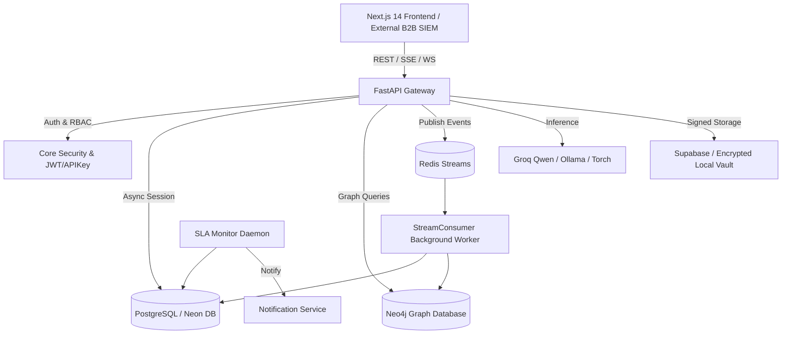

# Digital Rakshak — Codebase Audit & Architectural Baseline (CS-01 to CS-08)

**Document Version:** 1.0.0  
**Audit Date:** October 29, 2026  
**Auditor:** Antigravity Engineering Architecture Team  
**Starting Commit:** `80cce81`  
**Repository State:** Active Multi-Tier Deployment (FastAPI + Next.js 14/React 19 + PostgreSQL/Neon + Neo4j + Redis Streams)

---

## Executive Summary

Digital Rakshak is an Indian Cyber Threat Intelligence, Citizen Safety, and Enterprise Fraud Prevention Platform. Over successive hackathon and rapid-iteration sprints, comprehensive domain engines were added (RAIC orchestrator, RIE runtimes, B2B multi-tenancy, proximity radar, and monitored chat).

This audit establishes the rigorous, empirical baseline across all eight mandated sanitisation areas (**CS-01** to **CS-08**), cataloging critical latent bugs, security exposure risks, performance bottlenecks, and architectural debt before code modifications.

---

## 1. System Inventory & Dependency Map

### 1.1 Backend Topology (`backend/`)
* **API Routers (28 modules in `api/v1/`)**:
  * Case Management & Triage: `cases.py` (2,141 LOC), `admin_triage.py`, `admin_disputes.py`.
  * AI & Co-Pilot: `chat.py`, `chat_safety.py`, `help_chat.py`, `agents.py`, `assistance.py`, `scan.py`.
  * B2B & Commercial: `b2b.py`, `billing.py`, `transactions.py`.
  * Intelligence & Forensics: `evidence.py`, `graph.py`, `osint.py`, `police_proximity.py`, `locations.py`, `takedowns.py`.
  * Platform Core: `auth.py`, `users.py`, `settings.py`, `notifications.py`, `health.py`, `support.py`, `cache_router.py`, `stream_router.py`.
* **Domain Models (`domain/models/`)**: 18 SQLAlchemy models including `Case`, `User`, `Evidence`, `Notification`, `Organization`, `ApiKey`, `UsageQuota`, `CaseMessage`, `AuditEvent`.
* **Background Daemons & Workers (`runtime/`)**:
  * `sla_monitor_daemon.py`: Proactive hourly case SLA breach detector.
  * `stream_consumer.py`: Redis Streams consumer for two-stage threat event evaluation.
  * `supabase_keepalive.py`: Scheduled ping to prevent Neon/Supabase database pause.

### 1.2 Frontend Topology (`frontend/src/`)
* **Next.js App Router**:
  * Citizen Portal: `(dashboard)/citizen`, `(dashboard)/report`, `(dashboard)/account`.
  * Police & Investigator Workbench: `(dashboard)/workbench`, `(dashboard)/workbench/workspace/[case_number]`, `(dashboard)/police/victims-map`, `(dashboard)/workbench/graph`.
  * Banker Interface: `(dashboard)/banker`, `(dashboard)/banker/transactions`.
  * Administrator Command Center: `(dashboard)/admin/*` (tracker, disputes, AI health, approvals, settings).
  * Public Portal: `(public)/*` (locator, FAQ, terms, privacy).
* **UI & Component Layer**: 42 shared components in `components/ui/`, `components/case/`, `components/chat/`, `components/map/`.

### 1.3 High-Level Dependency Map



---

## 2. Baseline Measurements

| Metric Category | Observed Baseline | Notes |
| :--- | :--- | :--- |
| **Backend Tests Collected** | 90 tests | Collected across 22 test modules in `backend/tests/` |
| **Backend Test Execution** | Hanging on teardown | `backend/tests/conftest.py` async autouse fixture causes deadlocks |
| **Frontend Lint Status** | 0 errors, 512 warnings | `@typescript-eslint/no-unused-vars`, `react-hooks/set-state-in-effect` |
| **Frontend TypeScript** | 0 compile errors | Clean pass on `npx tsc --noEmit` |
| **Tracked Clutter Files** | 4 sensitive test dumps + 35 loose scripts | Directly in `backend/` root, interfering with pytest discovery |
| **Unreferenced Components** | 5 components | `CaseStepper`, `CaseTimeline`, `CaseActivityTimeline`, `ZtivfMeters`, `accordion` |

---

## 3. Findings & Vulnerability Matrix

### CS-01: Repository Hygiene
* **Finding CS-01-A (High)**: Tracked test files and session dumps in git.
  * *Affected Files*: `backend/admin_sessions.txt`, `backend/users.txt`, `backend/api_test.txt`, `temp_val.txt`, `frontend/lint-results.txt`, `frontend/frontend_log.txt`.
  * *Evidence*: These files contain raw outputs from manual testing sessions, including simulated tokens and user identities.
  * *Remediation*: Remove from git tracking (`git rm --cached`), add to `.gitignore`, and rotate any credentials that may have appeared in commit history.
* **Finding CS-01-B (Medium)**: Loose utility and experimental scripts polluting `backend/` root.
  * *Affected Files*: `backend/test_*.py` (14 files), `backend/fix_*.py` (6 files), `backend/check_*.py` (4 files), `backend/seed_*.py` (4 files).
  * *Evidence*: Standalone scripts starting with `test_` cause pytest to collect them as test suites. Their top-level network connections cause test collection hangs.
  * *Remediation*: Move enduring scripts into `backend/scripts/` and archive/remove ephemeral debug scripts.

### CS-02: Architecture
* **Finding CS-02-A (High)**: Oversized route handler in `cases.py` (2,141 lines).
  * *Affected Files*: `backend/api/v1/cases.py`.
  * *Evidence*: `cases.py` mixes HTTP routing, database queries, graph traversal, email dispatch, PDF report generation, and attack simulation.
  * *Remediation*: Modularize into discrete service helpers without altering endpoints or API contracts.
* **Finding CS-02-B (Medium)**: Duplicate UI components and unintegrated stepper.
  * *Affected Files*: `CaseTimeline.tsx` vs `CaseActivityTimeline.tsx`, unintegrated `CaseStepper.tsx`.
  * *Evidence*: Two separate timeline implementations exist, while `CaseStepper` was built but never embedded in citizen/investigator dashboards.
  * *Remediation*: Integrate `CaseStepper` into citizen and investigator views and standardize on one timeline component.

### CS-03: Security (Critical Priority)
* **Finding CS-03-A (Critical)**: Broken Object Level Authorization (BOLA) in Evidence Vault.
  * *Affected Files*: `backend/api/v1/evidence.py#L103-L104`.
  * *Evidence*:
    ```python
    if user.role in ["admin", "police", "cyber_cell", "banker", "bank_employee"]:
        return
    ```
    Any user with the role `"banker"` or `"bank_employee"` can access and download ANY evidence file on the platform, even for non-banking fraud, sexual harassment, or private citizen incidents.
  * *Remediation*: Restrict banker evidence access strictly to cases tagged as financial/banking fraud (`BANKING_FRAUD`, `UPI_FRAUD`, `CREDIT_CARD_FRAUD`, `LOAN_APP_SCAM`, `INVESTMENT_SCAM`). Restrict investigator access to assigned cases or jurisdictional stations.
* **Finding CS-03-B (High)**: Broken Function Level Authorization in Case AI Co-Pilot.
  * *Affected Files*: `backend/api/v1/chat.py#L168-L171`.
  * *Evidence*: Any police user can invoke `/{case_id}/chat` to extract full case facts, raw scam text, and AI intelligence for cases from other stations without assignment.
  * *Remediation*: Require case assignment or station match before generating AI case co-pilot summaries.

### CS-04: Backend Performance
* **Finding CS-04-A (Medium)**: Unindexed and unpaginated scans in SLA daemon.
  * *Affected Files*: `backend/runtime/sla_monitor_daemon.py#L50-L60`.
  * *Evidence*: Loads all investigating/assigned cases into Python memory every hour without composite indexes on `(status, created_at)`.
  * *Remediation*: Add composite index on `cases(status, priority, updated_at)` and query only potentially overdue records.

### CS-05: Frontend Optimisation
* **Finding CS-05-A (Medium)**: Cascading renders and missing hook dependencies (512 warnings).
  * *Affected Files*: `frontend/src/components/ui/loading-overlay.tsx#L61`, `frontend/src/hooks/use-transaction-stream.ts#L275`.
  * *Evidence*: Synchronously calling `setState()` inside `useEffect` triggers React cascading re-renders and degrades browser responsiveness.
  * *Remediation*: Refactor effects to decouple state synchronization and clean up unused imports.

### CS-06: Data Integrity
* **Finding CS-06-A (High)**: Latent Runtime NameError in Case Undertaking.
  * *Affected Files*: `backend/api/v1/cases.py#L1230`.
  * *Evidence*:
    ```python
    undertake_query = select(Case).where(or_(Case.case_number == case_number, Case.id == val_uuid)).with_for_update()
    ```
    `or_` is not imported in function scope, causing a `NameError: name 'or_' is not defined` whenever an investigator undertakes a case by UUID.
  * *Remediation*: Import `or_` at the module level in `cases.py`.
* **Finding CS-06-B (Medium)**: Missing `flag_modified` on JSONB mutations in SLA monitor.
  * *Affected Files*: `backend/runtime/sla_monitor_daemon.py#L173`.
  * *Evidence*: Modifying dictionary properties on `case.attack_dna` and `case.timeline_events` without calling `flag_modified` causes SQLAlchemy's change tracker to silently drop in-place dictionary updates.
  * *Remediation*: Explicitly call `flag_modified(c, "attack_dna")` and `flag_modified(c, "timeline_events")`.

### CS-07: Reliability
* **Finding CS-07-A (High)**: Pytest async autouse fixture blocks entire test execution.
  * *Affected Files*: `backend/tests/conftest.py#L4-L7`.
  * *Evidence*:
    ```python
    @pytest_asyncio.fixture(autouse=True)
    async def cleanup_db_engine():
        yield
        await engine.dispose()
    ```
    Applying an async autouse fixture to every test causes pytest-asyncio 1.4.0 on pytest 9.1 to hang during event loop teardown on synchronous tests.
  * *Remediation*: Remove `autouse=True` so engine disposal is selectively used only for async database integration tests.
* **Finding CS-07-B (Medium)**: In-process background task failure on serverless Vercel.
  * *Affected Files*: `backend/main.py#L74`, `backend/runtime/sla_monitor_daemon.py`.
  * *Evidence*: `asyncio.create_task` started in FastAPI `lifespan` freezes when Vercel serverless functions terminate after returning the HTTP response.
  * *Remediation*: Provide a secured cron endpoint `/api/v1/cases/sla/evaluate-cron` authenticated with `CRON_SECRET` for reliable execution.

### CS-08: Verification
* **Finding CS-08-A (High)**: Unexecuted test suite due to conftest hang.
  * *Affected Files*: `backend/tests/*.py`.
  * *Remediation*: Fix conftest fixture and execute the full 90-test suite across unit, security, and pipeline tests.

---

## 4. Prioritized Execution Sequence

1. **Batch 1 (Security & Correctness)**:
   * Fix `or_` NameError in `cases.py`.
   * Harden banker BOLA in `evidence.py`.
   * Enforce investigator assignment check in `chat.py`.
   * Fix `tests/conftest.py` teardown deadlock.
   * Untrack sensitive `.txt` files and update `.gitignore`.
2. **Batch 2 (Frontend Hygiene & CaseStepper Integration)**:
   * Integrate `CaseStepper` into Citizen and Investigator views.
   * Fix cascading `setState` in `loading-overlay.tsx` and `use-transaction-stream.ts`.
   * Clean up 512 ESLint warnings.
3. **Batch 3 (Repository Cleanup & Full Verification)**:
   * Reorganize loose scripts into `backend/scripts/`.
   * Run full test suite and build verification.
   * Deliver `SECURITY_AUDIT.md`, `PERFORMANCE_REPORT.md`, and `RELEASE_READINESS.md`.
