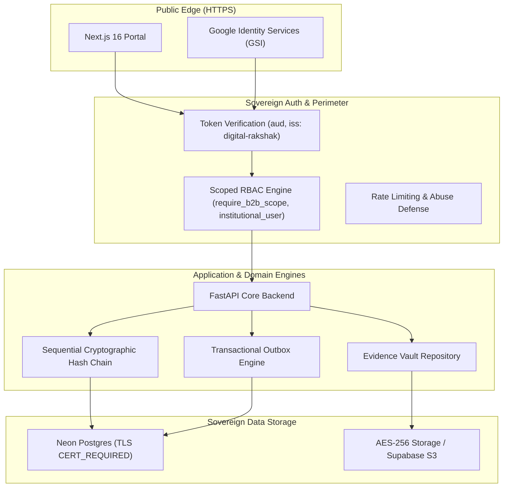

# Digital Rakshak Security Architecture

## 1. System Overview & Trust Boundaries
Digital Rakshak operates across three primary security boundaries:
1. **Public Edge**: Citizen Web Portal (Next.js 16) and Public Ingestion Gateways (`/v1/scan`, `/auth/*`).
2. **Institutional & B2B Perimeter**: Role-gated APIs for law enforcement (`police`, `cyber_cell`), banking investigators (`banker`, `bank_employee`), and institutional API consumers (`/v1/b2b/*`, `/v1/transactions/*`).
3. **Core Sovereign Vault**: Neon PostgreSQL with strict TLS, evidence vault storage, and cryptographic audit ledgers.



---

## 2. Identity, Authentication & Token Security

### 2.1 Google OAuth 2.0 Identity Services (GSI)
* **Frontend Sign-In**: Client initializes Google Identity Services (`window.google.accounts.id`) with the configured `NEXT_PUBLIC_GOOGLE_CLIENT_ID`.
* **Backend Verification**: Server calls `google.oauth2.id_token.verify_oauth2_token`:
  - `aud`: Strictly matched against `settings.GOOGLE_CLIENT_ID`.
  - `iss`: Validated against `accounts.google.com` and `https://accounts.google.com`.
  - `email_verified`: Asserts `True` before creating or retrieving a user account.
* **Production Sandbox Isolation**: Mock authentication tokens (`mock_google_token_...`) are strictly rejected in production environments via runtime checks:
  ```python
  if settings.ENVIRONMENT != "production" and os.getenv("VERCEL") != "1":
      # Development/sandbox bypass permitted only here
  ```

### 2.2 Sovereign JWT Token Architecture
* **Issuer Claims**: Sovereign access tokens generated by Digital Rakshak mandate `iss: "digital-rakshak"`. Tokens missing or with invalid issuers are rejected.
* **Institutional Approval Gate**: Institutional roles (`police`, `cyber_cell`, `banker`, `bank_employee`) require verified nodal approval (`user.is_approved is True`). Unapproved institutional accounts cannot connect to WebSockets (`get_current_user_ws`) or query optional user endpoints (`get_current_user_optional`).

---

## 3. Multi-Tenant Authorization & Scoped RBAC

### 3.1 Role Hierarchy
* **`citizen`**: Consumer protection portal, unlimited heuristic threat scans, incident reporting.
* **`banker` / `bank_employee`**: Bank Fraud Response Console, transaction analysis, freeze requisition routing.
* **`police` / `cyber_cell`**: Evidence inspection, spatial suspect clustering, Section 94 BNSS notices.
* **`admin`**: System configuration, approval directory, institutional user lifecycle.

### 3.2 B2B Scoped API Key Engine
API keys issued to enterprise and banking institutions enforce granular capability scopes:
* `events:write`: Grants access to ingest transaction telemetry (`POST /v1/b2b/events/ingest`).
* `alerts:read`: Grants read-only access to threat stream feeds (`GET /v1/b2b/events/stream`) and STIX intelligence.
* `keys:manage`: Administrative capability to generate or revoke API keys.

---

## 4. Cryptographic Foundations & Audit Ledgers

### 4.1 Sequential Cryptographic Hash Chain
The fraud lifecycle engine implements a **Sequential Cryptographic Hash Chain** (linear tamper-evident ledger):
$$H_0 = \text{GENESIS\_HASH} = 0^{64}$$
$$H_n = \text{SHA256}(H_{n-1} \parallel \text{CorrelationId} \parallel \text{Stage} \parallel \text{Actor} \parallel \text{TimestampISO} \parallel \text{CanonicalMetadata})$$

* **Integrity Invariant**: Any modification, insertion, or reordering of historical records breaks the hash linkage ($H_{n-1} \neq \text{expected}$).
* **Statutory Boundary**: This construction provides cryptographic tamper evidence to support Section 63 electronic record submissions under Bharatiya Sakshya Adhiniyam, 2023. It does not replace statutory certificate signing by a designated officer.

### 4.2 Privacy Geolocation Jitter
Public case radar queries apply deterministic SHA-256 jitter to victim coordinates, preventing residential de-anonymization:
$$\text{seed} = \text{SHA256}(\text{CaseID} \parallel \text{SECRET\_KEY})$$

---

## 5. Storage Security & Evidence Vault Repository (EVR)

### 5.1 Component-Aware Path Traversal Hardening
Local evidence downloads use path-component containment:
* **Resolution**: Canonical paths are resolved with `pathlib.Path.resolve()`.
* **Boundary Validation**: Checks `target_path.is_relative_to(base_dir)`. Sibling directories (e.g. `/evidence_vault_evil`) are rejected.
* **Symlink Elimination**: Explicit rejection of symlinks (`target_path.is_symlink()`).
* **TOCTOU Guard**: Verifies `target_path.is_file()` strictly on resolved descriptors.

### 5.2 Malicious Extension Quarantine
Prohibits executable and active script files from being uploaded or rendered in the vault:
`.svg`, `.html`, `.htm`, `.xhtml`, `.js`, `.mjs`, `.py`, `.jar`, `.exe`, `.sh`.

---

## 6. Infrastructure & Network Perimeter

### 6.1 Database Security (Neon PostgreSQL)
* In production (`settings.ENVIRONMENT == "production"`), the database connection pool mandates strict TLS certificate validation (`ssl.CERT_REQUIRED`, `check_hostname = True`).
* Foreign key cascades on user deletion are handled safely by nullifying references (`api_keys.created_by`, `support_tickets.user_id`) to avoid constraint crashes.

### 6.2 Transactional Outbox Pattern
* Ensures atomic state consistency between local relational state changes and outbound PSP notifications.
* Guarantees local event durability and at-least-once retry delivery; downstream execution remains subject to target institution availability.
